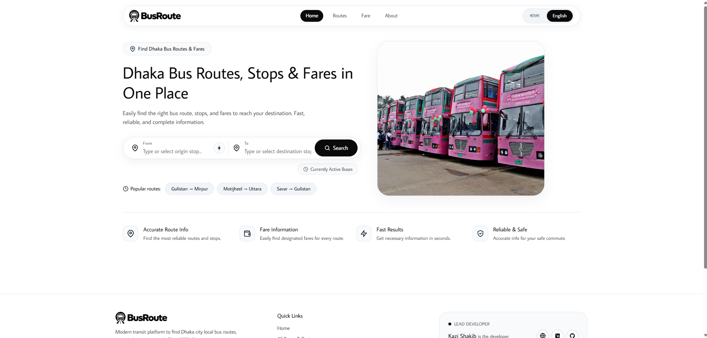
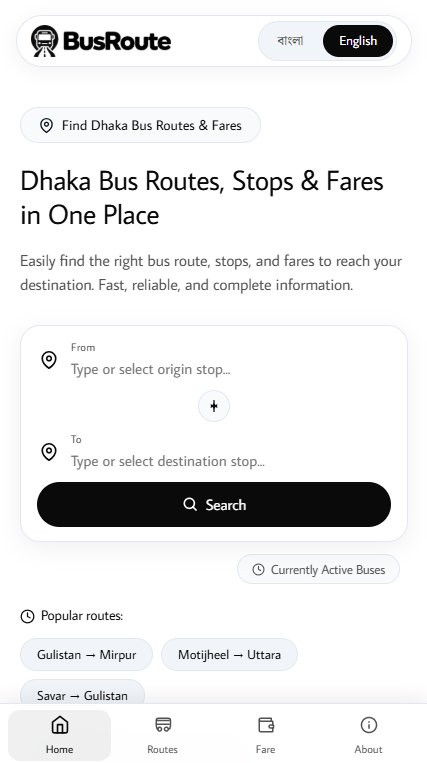

<p align="center">
  
</p>

# BusRoute (বাসরুট)

Dhaka local bus routes, stops and estimated fares in one place. Pick a start and a destination, see which buses run between them, open the stop list and map, and check the fare. The interface switches between Bengali and English.

Live: [mybusroute.vercel.app](https://mybusroute.vercel.app)

## Preview

<table>
  <tr>
    <td align="center"><b>Desktop</b></td>
    <td align="center"><b>Mobile</b></td>
  </tr>
  <tr>
    <td></td>
    <td></td>
  </tr>
</table>

## Features

- Route search between two stops, with fuzzy matching for stop names
- 176 local bus routes and 273 stops
- Stop-by-stop lists and a map for each route (Leaflet)
- Fare estimate from route distance
- Bengali and English interface
- Runs in the browser, no account needed

## Run locally

You need Node.js 18 or newer.

```bash
git clone https://github.com/thekazishakib/mybusroute.git
cd mybusroute
npm install
npm run dev
```

Open http://localhost:3000.

Other commands:

```bash
npm test         # tests
npm run lint     # type check
npm run build    # production build in dist/
```

## Environment

Optional. Copy `.env.example` to `.env` to set the public site URL used in SEO tags:

```
VITE_SITE_URL="https://mybusroute.vercel.app"
```

## Deploy on Vercel

1. Import the repository in Vercel.
2. Framework preset: Vite.
3. Build command `npm run build`, output directory `dist`.
4. Add `VITE_SITE_URL` as an environment variable and deploy.

`vercel.json` already handles client-side routing.

## Data

- Bus routes and stops come from the "Local Bus" listing on dhakatc.com, read by OCR and checked by hand. Some stops are missing and some names may be misspelled, see [data/REPORT.md](data/REPORT.md) for the known gaps.
- Fares are estimates calculated from route distance at Tk 2.70 per km with a minimum of Tk 10 (see `src/data/fare.ts`). Actual fares can differ by a few taka.
- Route lines on the map are fetched from the public OSRM service.

## Author

Built by [Kazi Shakib](https://www.kazishakib.com) ([GitHub](https://github.com/thekazishakib), [LinkedIn](https://bd.linkedin.com/in/kazishakib)).

## License

[MIT](LICENSE). The Noto Serif Bengali and Average Sans fonts are under the SIL Open Font License 1.1.